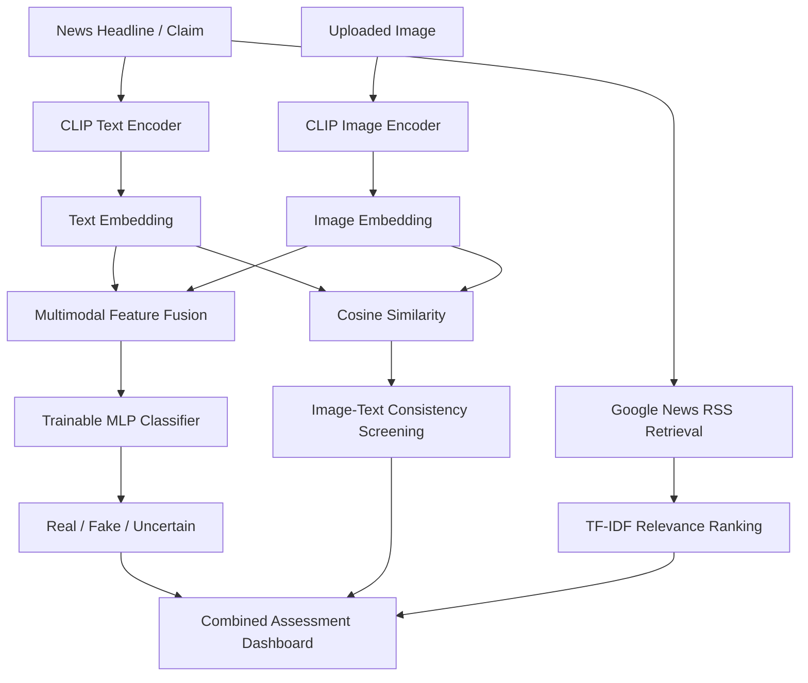

# 📰 Multimodal Fake News Detection Using Vision-Language Models

A multimodal AI research project that analyzes news claims using both textual and visual information. Built using **OpenAI CLIP (ViT-B/32), PyTorch, and Streamlit**, the system combines fake-news classification, image-text consistency screening, and external news evidence retrieval.

The goal is to explore how vision-language models can help identify potentially misleading news content.

---

## 🚀 Project Overview

Traditional fake-news classification systems often rely only on textual information. However, online news posts frequently contain both text and images.

This project uses a multimodal approach to analyze both inputs together.

The system provides three independent analysis signals:

1. **AI Classification:** Predicts whether a news post is Real or Fake.
2. **Image-Text Consistency:** Measures semantic similarity between the submitted text and image using CLIP.
3. **External News Evidence:** Retrieves related news coverage to help users investigate a claim.

These signals are presented separately to avoid treating model predictions or similarity scores as definitive proof of truth.

## ✨ Key Features

- Multimodal text and image classification.
- CLIP ViT-B/32 pretrained vision-language encoder.
- Frozen CLIP backbone with a trainable fusion classifier.
- Text-image cosine similarity analysis.
- Confidence-based Uncertain classification.
- Validation-calibrated image consistency threshold.
- External news retrieval using Google News RSS.
- TF-IDF-based topical relevance ranking.
- Interactive Streamlit dashboard.
- Evaluation using accuracy, precision, recall, F1-score, ROC-AUC, and confusion matrices.

## 🧠 System Architecture



### Model Architecture

The project uses `openai/clip-vit-base-patch32` to generate normalized text and image embeddings.

The fusion classifier receives five feature groups:

- Text embedding
- Image embedding
- Absolute difference between embeddings
- Element-wise product of embeddings
- Cosine similarity between text and image embeddings

These features are passed through a multilayer perceptron (MLP) that predicts two classes:

| Label | Meaning |
|---|---|
| 0 | Real |
| 1 | Fake |

The CLIP backbone is frozen during training, while the fusion classifier is trained using the Fakeddit dataset.

## 📊 Dataset

**Dataset:** Fakeddit

The project uses the multimodal Fakeddit dataset containing news-related text and images.

After image availability and data-quality filtering, the usable image-text pairs were:

| Split | Usable pairs |
|---|---:|
| Training | 51,316 |
| Validation | 5,712 |
| Testing | 5,676 |
| **Total** | **62,704** |

Raw dataset files and downloaded images are excluded from this GitHub repository because of their size.

Users must obtain the dataset separately and prepare the expected TSV files and image directory.

## 🏆 Model Performance

The trained multimodal classifier achieved the following results on the held-out Fakeddit test split:

| Metric | Score |
|---|---:|
| Accuracy | **91.90%** |
| Macro Precision | 91.11% |
| Macro Recall | 92.33% |
| Macro F1-score | **91.59%** |

### Per-Class Performance

| Class | Precision | Recall | F1-score |
|---|---:|---:|---:|
| Real | 96.16% | 90.42% | 93.20% |
| Fake | 86.07% | 94.25% | 89.97% |

### Image-Text Consistency Evaluation

A separate evaluation was performed using original matched text-image pairs and synthetic mismatched pairs created by randomly swapping images within the same split.

The similarity threshold was calibrated on validation data using maximum Youden's J statistic.

| Metric | Test result |
|---|---:|
| Threshold | 0.21961 |
| Accuracy | 84.21% |
| Balanced Accuracy | 84.21% |
| Precision | 90.44% |
| Recall | 76.50% |
| F1-score | 82.89% |
| ROC-AUC | **92.41%** |

**Important:** These are two separate evaluations. The 91.90% accuracy measures Real/Fake classification on Fakeddit. The consistency metrics measure the distinction between original image-text pairs and synthetic image mismatches. Neither result represents real-world fact-checking accuracy.

## 🖥️ Application Dashboard

The Streamlit application allows users to:

1. Enter a news headline or claim.
2. Upload its associated image.
3. View the classifier's prediction and probabilities.
4. Inspect CLIP image-text similarity.
5. Receive a review recommendation when appropriate.
6. Retrieve related news coverage for further investigation.

### Screenshots

Add your application screenshots here:

```text
docs/
└── screenshots/
    ├── dashboard.png
    ├── fake-prediction.png
    └── evidence-results.png
```

Once added, you can display them using:

```markdown

```

## 🛠️ Technology Stack

| Technology | Purpose |
|---|---|
| Python | Core programming language |
| PyTorch | Deep learning framework |
| Hugging Face Transformers | CLIP implementation |
| CLIP ViT-B/32 | Vision-language feature extraction |
| Pandas & NumPy | Data processing |
| Scikit-learn | Evaluation and TF-IDF |
| Streamlit | Interactive web application |
| Matplotlib | Evaluation visualizations |
| BeautifulSoup & Requests | External article retrieval |

## 📁 Project Structure

```text
multimodal-fake-news-detection/
│
├── app/
│   ├── app.py
│   ├── predict.py
│   └── evidence.py
│
├── src/
│   ├── dataset.py
│   ├── model.py
│   ├── train.py
│   ├── evaluate.py
│   ├── evaluate_consistency.py
│   ├── predict.py
│   └── evidence.py
│
├── scripts/
│   ├── download_images.py
│   ├── inspect_dataset.py
│   └── prepare_samples.py
│
├── config/
│   └── config.yaml
│
├── data/
│   ├── raw/
│   ├── processed/
│   └── images/
│
├── checkpoints/
├── outputs/
│
├── requirements.txt
├── .gitignore
└── README.md
```

## ⚙️ Installation and Setup

### 1. Clone the repository

```bash
git clone https://github.com/Svayum-dev/multimodal-fake-news-detection.git
cd multimodal-fake-news-detection
```

### 2. Create a virtual environment

Windows PowerShell:

```powershell
python -m venv .venv
.venv\Scripts\Activate.ps1
```

### 3. Install dependencies

```bash
pip install -r requirements.txt
```

For GPU acceleration, install a compatible CUDA-enabled PyTorch build for your system using the official PyTorch installation instructions.

### 4. Prepare the dataset

Obtain the Fakeddit dataset separately.

Place the TSV files in `data/raw/`:

```text
data/raw/
├── train_56000.tsv
├── validate_6000.tsv
└── test_6000.tsv
```

Download and prepare the associated images using the project scripts. The images should be stored in:

```text
data/images/
```

### 5. Train the model

If you do not already have a trained checkpoint, run:

```bash
python -m src.train --train data/raw/train_56000.tsv --val data/raw/validate_6000.tsv --epochs 5 --batch-size 16
```

The best model checkpoint is saved to:

```text
checkpoints/best_model.pt
```

The first run downloads the pretrained CLIP model from Hugging Face.

### 6. Run the application

Make sure `checkpoints/best_model.pt` exists, then execute:

```bash
streamlit run app/app.py
```

The application will open in your browser.

## 📦 Model Checkpoints

Trained model weights are not included in this repository because each checkpoint is approximately 582 MB.

The application expects:

```text
checkpoints/best_model.pt
```

You can generate this checkpoint by running the training command above or obtain the corresponding trained weights separately.

## ⚠️ Limitations

- Fakeddit labels are dataset annotations, not universal factual ground truth.
- The classifier may misclassify claims outside the training distribution.
- CLIP similarity measures semantic alignment, not factual truth.
- A low image-text similarity score does not prove that a news claim is fake.
- Google News retrieval and TF-IDF scores measure topical relevance, not whether an article supports or contradicts a claim.
- The system does not independently verify the authenticity, date, or manipulation history of an image.

This project is a research prototype and should be treated as a decision-support tool rather than an authoritative fact-checking system.

## 🔮 Future Improvements

- Add explainability techniques for multimodal predictions.
- Evaluate on additional datasets such as VERITE and NewsCLIPpings.
- Improve confidence calibration and uncertainty estimation.
- Add source credibility analysis.
- Investigate image manipulation detection.
- Compare frozen CLIP against fine-tuned vision-language models.
- Improve evidence retrieval and claim verification.

## 👨‍💻 Author

**Svayum Kapoor**

B.Tech Computer Science and Engineering — AI/ML

GitHub: [@Svayum-dev](https://github.com/Svayum-dev)

---

⭐ If you find this project interesting, consider giving the repository a star.

**Disclaimer:** This project is developed for academic and research purposes. Its predictions should not be interpreted as definitive determinations of whether a news claim is true or false.